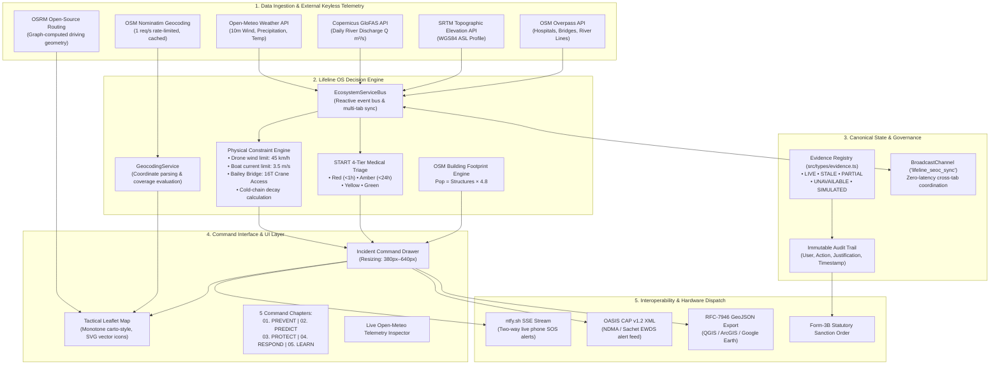

# LIFELINE OS — SYSTEM ARCHITECTURE SPECIFICATION

## 1. Executive Summary & Core Mission
**Lifeline OS** is a disaster-management operating system engineered for State Emergency Operations Centres (SEOC), District Disaster Management Authorities (DDMA), incident commanders, and logistics coordinators.
It transforms heterogeneous geospatial, meteorological, hydrological, and clinical evidence into traceable, legally defensible, and physically constrained operational decisions during catastrophic flood and infrastructure severance disasters.

---

## 2. Architecture Diagram

---

## 3. Technology Stack & Architectural Decisions

### Frontend Framework
- **React 19 & TypeScript 5.7**: Strict typing, no implicit `any`, modern hook paradigms.
- **Tailwind CSS 4.0**: Utility-first styling with hardware-accelerated transitions and responsive constraints.
- **Leaflet 1.9 & Custom SVG Canvas**: Interactive, high-performance tactical map without expensive commercial map licensing fees. Monotone base tiles (`CartoDB DarkMatter / Positron`) preserve eye focus on tactical corridors.
- **Lucide Icons & Vector Tactical SVG Assets**: Handcrafted, scalable vector symbols for Class-40 Bailey Bridges, Forward Hospital Camps, NDRF Boats, and Heavy Med-Drones.

### Backend & API Aggregator
- **Express 4.21 with Node.js & TypeScript (`tsx server.ts`)**: Fast HTTP routing, static distribution, and lightweight proxying.
- **Google GenAI SDK (`@google/genai`)**: Optional generative briefing copilot (`/api/genai/chat`), with deterministic graceful fallbacks if offline or unkeyed.

### External Keyless APIs (Zero-Cost, Unlimited Hackathon Replicability)
1. **Open-Meteo Weather Forecast API**: Real-time 10m wind speed, precipitation, 2m ambient temperature, barometric surface pressure.
2. **Copernicus GloFAS Flood Discharge API**: Continental river discharge ($Q\text{ m}^3/\text{s}$) updated daily.
3. **Open-Meteo SRTM Topographic Elevation API**: 90m shuttle radar topography for terrain ASL analysis.
4. **OpenStreetMap Nominatim API**: Open geocoding and reverse geocoding with strict 1 req/s client rate limiting.
5. **OpenStreetMap Overpass API**: Live query engine for hospitals, bridges, roads, and waterways.
6. **ntfy.sh SSE & HTTP POST API**: Keyless server-sent events (SSE) WebSocket bridge for real physical smartphone two-way SOS broadcast.

---

## 4. Multi-Terminal Synchronization Architecture
- **Transport**: `BroadcastChannel` API (`channel: 'lifeline_seoc_sync'`).
- **Data Exchange**: Event-driven JSON payloads for `INBOUND_FIELD_SOS`, `INTERVENTION_CHANGE`, and `SANCTION_DISPATCH`.
- **Latency**: Sub-5ms intra-browser synchronization between separate operator screens (e.g. Commander Overview vs Logistics Dispatcher).

---

## 5. Security, Provenance & Human-In-The-Loop Governance
- **No Autonomous Physical Action**: The system produces actionable recommendations and sanction drafts. No drone, boat, bridge, or mass SMS dispatch is executed without explicit human commander authorization (`AuthorizationState: DRAFT -> SUBMITTED -> APPROVED -> DISPATCHED`).
- **Provenance Tagging**: Every displayed number carries metadata: `sourceTrust`, `retrievalTimestamp`, `measurementType`, and `dataState`.
- **Degraded Network Resilience**: In the event of telecommunication collapse, the system fails honestly: missing fields display `"Data unavailable"` instead of synthetic approximations masquerading as truth.
